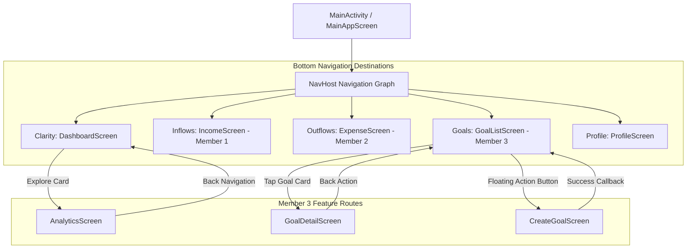
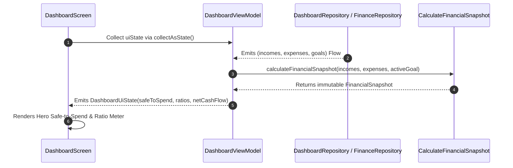
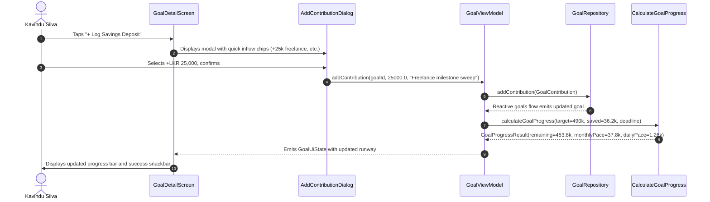

# SE3092: Platform Based Development — Assignment 01
## Member 3 Technical Design Document & Architecture Specification
**Role:** Financial Intelligence and Goal Engineer (Member 3)  
**System:** Android Personal Finance Management System for Kavindu Silva  
**Target Platform:** Android (minSdk 26, targetSdk 34+)  
**Technology Stack:** 100% Kotlin, Jetpack Compose (Material Design 3), Navigation Compose, MVVM + Coroutines & StateFlow, Firebase Firestore & Room Local Cache, JUnit.  

---

## 1. System Overview & Scenario Context (Kavindu Silva)

### 1.1 Persona Challenges & Behavioral Friction
Kavindu Silva, a 25-year-old junior software engineer in Colombo, faces three fundamental financial frictions:
1. **Volatile Multi-Source Income Inflows:** A monthly base engineering salary (LKR 120,000–140,000), irregular milestone-based freelance earnings (LKR 20,000–90,000 per project), foreign currency blog earnings paid in USD (Google AdSense), and speculative crypto trading gains/losses.
2. **Invisible Daily Outflows:** Fragmented, frictionless spending across credit cards, debit cards, cash ATM withdrawals, ride-hailing (PickMe), and food delivery apps (UberEats), with zero segregation between fixed non-negotiables (LKR 34,000 rent) and discretionary lifestyle choices.
3. **The Disconnected MacBook Pro M4 Goal:** A savings target of LKR 490,000 within 12 months. Despite earning more than LKR 1.6 million annually, he had saved only LKR 11,200 because daily financial decisions were isolated from the long-term target.

### 1.2 Member 3 Ownership Scope
As the **Financial Intelligence and Goal Engineer**, Member 3 designs, implements, and tests:
* **Module A (Dashboard & Financial Overview):** Aggregating real-time cash flow, computing the daily Safe-to-Spend burn allowance, and presenting period summaries.
* **Module B (Savings Goals & Contributions Engine):** Tracking the MacBook Pro M4 target, computing required monthly/daily savings velocity, handling overdue/completed states, and managing the deposit ledger.
* **Module C (Financial Analytics & Visualisations):** Visualizing expense category distributions, committed vs. discretionary spending splits, and multi-source income breakdowns without external heavy charting dependencies.
* **Shared Architecture:** Main authenticated navigation shell (`AppNavGraph`), reactive contracts (`FinancialSnapshot`, `SavingsGoal`, `DashboardRepository`, `GoalRepository`), and unit test suites.

---

## 2. MVVM Architecture & Clean Layer Mapping

The system strictly adheres to the Model-View-ViewModel (MVVM) architecture with Unidirectional Data Flow (UDF) and Clean Architecture separation:

```
┌─────────────────────────────────────────────────────────────────────────┐
│                       UI Layer (Jetpack Compose)                        │
│   DashboardScreen      GoalListScreen      GoalDetailScreen             │
│   CreateGoalScreen     AnalyticsScreen     AppNavGraph                  │
└────────────────────────────────────▲────────────────────────────────────┘
                                     │  (StateFlow<UiState> / Events)
┌────────────────────────────────────▼────────────────────────────────────┐
│                       ViewModel Layer (StateFlow)                       │
│   DashboardViewModel      GoalViewModel      AnalyticsViewModel         │
└────────────────────────────────────▲────────────────────────────────────┘
                                     │  (Invokes Use Cases & Repositories)
┌────────────────────────────────────▼────────────────────────────────────┐
│                      Domain Layer (Pure Kotlin)                         │
│   CalculateFinancialSnapshot        CalculateGoalProgress               │
│   FinancialSnapshot                 SavingsGoal / GoalContribution      │
│   DashboardRepository (Interface)   GoalRepository (Interface)          │
└────────────────────────────────────▲────────────────────────────────────┘
                                     │  (Flow Reactive Streams)
┌────────────────────────────────────▼────────────────────────────────────┐
│                       Data Layer (Repositories)                         │
│   DashboardRepositoryImpl           FakeDashboardRepository             │
│   FakeGoalRepository                FinanceRepository (Singleton SSOT)  │
└────────────────────────────────────▲────────────────────────────────────┘
                                     │
           ┌─────────────────────────┴─────────────────────────┐
           ▼                                                   ▼
┌─────────────────────────┐                         ┌─────────────────────┐
│  Firebase Cloud Backend │                         │  Local Cache (Room) │
│  Firestore Collections  │                         │  SQLite Persistence │
└─────────────────────────┘                         └─────────────────────┘
```

### 2.1 Architectural Enforcements
1. **Zero Business Logic in Composables:** Compose UI functions only render immutable `UiState` and dispatch typed events. All currency formatting, runway calculations, and category aggregations occur in pure Kotlin domain components or ViewModels.
2. **Strict UDF State Containment:** ViewModels hold state in private `MutableStateFlow` instances and expose public, read-only `StateFlow` streams.
3. **Structured Concurrency:** All asynchronous operations are launched within `viewModelScope` and cancelled automatically when composables leave the back-stack.

---

## 3. Navigation Graph & Single-Activity Architecture

The application uses **Navigation Compose** within a single `MainActivity`. The bottom navigation bar hosts five top-level destinations, with sub-routes for goal deep-dives:



---

## 4. Dashboard Screen-to-ViewModel-to-Repository Mapping



---

## 5. Savings Goal Data Flow & Runway Mechanics



---

## 6. FinancialSnapshot Data Flow & Aggregation Engine

To decouple the UI from raw database schemas, `FinancialSnapshot` serves as the authoritative, typed data carrier:

```kotlin
data class FinancialSnapshot(
    val period: DatePeriod = DatePeriod.allTime(),
    val totalIncomeLkr: Double = 0.0,
    val totalExpenseLkr: Double = 0.0,
    val netCashFlowLkr: Double = 0.0,
    val savingsRate: Double = 0.0,
    val committedExpenseLkr: Double = 0.0,
    val discretionaryExpenseLkr: Double = 0.0,
    val safeToSpendDailyLkr: Double = 0.0,
    val incomeBySource: List<IncomeBySource> = emptyList(),
    val expenseByCategory: List<ExpenseByCategory> = emptyList(),
    val activeGoalSummary: GoalSummary? = null,
    val isOffline: Boolean = false,
    val lastUpdatedEpochMs: Long = System.currentTimeMillis()
)
```

The aggregation interactor `CalculateFinancialSnapshot` executes the following transformations:
1. **Date Boundary Filtering:** Incomes and expenses are filtered by `[period.startEpochMs, period.endEpochMs]`.
2. **Realized Income Filtering:** Only records with `InvoiceStatus.RECEIVED` or `SETTLED` are counted; pending freelance milestones are segregated from liquid cash.
3. **Categorical & Stream Groupings:** Groups expenses by category and incomes by source type, computing both absolute LKR values and percentages.
4. **Committed vs. Discretionary Segmentation:** Splits expenditures based on `ExpenseNature.COMMITTED` versus `ExpenseNature.DISCRETIONARY`.

---

## 7. Goal Calculation Design, Assumptions & Edge Cases

The pure Kotlin component `CalculateGoalProgress` enforces the following mathematical rules:

$$\text{remainingAmountLkr} = \max(0.0, \text{targetAmountLkr} - \text{currentContributionTotalLkr})$$

$$\text{progressFraction} = \text{clamp}\left(0.0, \frac{\text{currentContributionTotalLkr}}{\text{targetAmountLkr}}, 1.0\right)$$

$$\text{remainingMonths} = \left\lceil \frac{\text{deadlineEpochMs} - \text{currentEpochMs}}{30.4375 \times 24 \times 3600 \times 1000} \right\rceil$$

$$\text{requiredMonthlyContributionLkr} = \begin{cases} 
0.0 & \text{if goal is completed or overdue} \\ 
\frac{\text{remainingAmountLkr}}{\text{remainingMonths}} & \text{if remainingMonths} > 0 \\ 
\text{remainingAmountLkr} & \text{otherwise} 
\end{cases}$$

### Edge Case Handlers:
* **Overdue Goals:** If `currentEpochMs > deadlineEpochMs` and the goal remains incomplete, `isOverdue = true` and `requiredMonthlyContributionLkr = 0.0` to avoid misrepresenting future monthly schedules.
* **Exceeded Target:** If contributions exceed the target (e.g. LKR 550,000 on a 490,000 goal), the visual progress bar is clamped to `1.0f`, while preserving the actual stored total without truncation.
* **Zero or Negative Target:** Validated defensively; returns `isValid = false` with an explicit error message.

---

## 8. Dashboard Calculation Rules & Daily Safe-to-Spend Formula

To eliminate false liquidity (where Kavindu sees cash in his bank account and spends it before his LKR 34,000 rent is deducted), the system computes the **Daily Safe-to-Spend Allowance**:

$$\text{Remaining For Lifestyle} = \max\left(0.0, \text{Realized Inflow} - \text{Committed Bills} - \text{Monthly MacBook Savings Pace}\right)$$

$$\text{Safe-to-Spend}_{\text{Daily}} = \frac{\text{Remaining For Lifestyle}}{\text{Days Remaining in Cycle (default: 30)}}$$

* **Negative Net Cash Flow:** When expenses exceed income, `netCashFlowLkr` is negative, `isDeficit = true`, and `safeToSpendDailyLkr = 0.0`. Negative cash flow is never displayed as positive savings.
* **Zero Income Handling:** When income is 0, division by zero is strictly guarded; `savingsRate` returns `0.0`.

---

## 9. Analytics & Visualisation Design Decisions

Per Section 8.2 of the specification, the application uses **native Jetpack Compose and Canvas visualisations** instead of heavy, incompatible third-party charting libraries:

1. **Expense Category Donut Chart (`ExpenseCategoryChart.kt`):**
   * Uses Compose `Canvas` drawing arcs with a stroke width of `32f` and a curated, high-contrast palette (`CategoryPalette`).
   * Displays the total spend figure in the center hole of the donut.
   * Accompanied by textual legend rows displaying the category name, LKR amount, and exact percentage.
2. **Committed vs. Discretionary Split Ratio Meter (`CommittedVsDiscretionaryCard.kt`):**
   * High-contrast dual progress bar using `CommittedBlue` and `DiscretionaryOrange`.
   * Directly exposes Kavindu's discretionary leakage across PickMe, UberEats, and artisan dining.
   * Includes a dynamic behavioral insight card.
3. **Multi-Source Inflow Breakdown (`IncomeSourceChart.kt`):**
   * Segmented horizontal bars for each stream: Salary (predictable), Freelance (milestone), AdSense (USD remittance), and Crypto (realized trading).

---

## 10. Annotated Text Wireframes for Core Screens

### 10.1 Screen 1: Financial Dashboard (`DashboardScreen`)
```
┌────────────────────────────────────────────────────────┐
│ Financial Clarity                     [● LIVE] (⚙)    │
│ Real-time Cashflow & Target Runway                     │
├────────────────────────────────────────────────────────┤
│ HERO CARD: DAILY SAFE-TO-SPEND                         │
│ LKR 3,386.67                                           │
│ Available to spend today after locking in committed   │
│ rent (LKR 34k), utilities, and MacBook fund.           │
├────────────────────────────────────────────────────────┤
│ MONTHLY CASHFLOW SUMMARY                               │
│ Inflow: +LKR 180,000  | Outflows: -LKR 76,450          │
│ Net Surplus: LKR 103,550.00 (Savings Rate: 57%)        │
├────────────────────────────────────────────────────────┤
│ TARGET SAVINGS GOAL: MacBook Pro M4                    │
│ [====>                       ] 2.3% (LKR 11,200 Saved) │
│ Deficit: LKR 478,800.00 | Pace: LKR 39,900.00 / month  │
│ [ + Quick Deposit ]                  [ Edit Target ]   │
├────────────────────────────────────────────────────────┤
│ 50/30/20 BUDGET RATIO METER                            │
│ Committed: 50% | Discretionary: 30% | Savings: 20%     │
├────────────────────────────────────────────────────────┤
│ [📊 Financial Analytics & Breakdown          Explore →]│
└────────────────────────────────────────────────────────┘
```

### 10.2 Screen 2: Savings Goals Overview (`GoalListScreen`)
```
┌────────────────────────────────────────────────────────┐
│ Savings Goals                                          │
│ Aspirational targets linked to your cash flow          │
├────────────────────────────────────────────────────────┤
│ ┌────────────────────────────────────────────────────┐ │
│ │ MacBook Pro M4 (14-inch)               [ ACTIVE ]  │ │
│ │ Target: LKR 490,000.00                             │ │
│ │ [===>                                  ] 2.3%      │ │
│ │ Saved: LKR 11,200.00   Remaining: LKR 478,800.00   │ │
│ │                                  [+ Quick Deposit] │ │
│ └────────────────────────────────────────────────────┘ │
│                                                        │
│                                           [ (➕ FAB) ] │
└────────────────────────────────────────────────────────┘
```

### 10.3 Screen 3: Financial Analytics (`AnalyticsScreen`)
```
┌────────────────────────────────────────────────────────┐
│ Financial Analytics                                    │
│ [ All Time ]  [ This Month ]  [ Last Month ]  [ This Yr]│
├────────────────────────────────────────────────────────┤
│ COMMITTED VS. DISCRETIONARY SPENDING                   │
│ [███████████████████████████░░░░░░░░░░░░░░░░░░░░░░░░░] │
│ ■ Committed: LKR 38,500 (50%)  ■ Discretionary: 37.9k  │
│ 💡 Insight: Discretionary spend is where budget leaks. │
├────────────────────────────────────────────────────────┤
│ EXPENSE DISTRIBUTION BY CATEGORY                       │
│                   ┌─────────┐                          │
│                   │ (Donut) │ Total: LKR 76,450.00     │
│                   └─────────┘                          │
│ • Rent & Housing: LKR 34,000.00 (44.5%)                │
│ • Food & Dining:  LKR 24,000.00 (31.4%)                │
│ • PickMe Cab:     LKR 13,950.00 (18.2%)                │
├────────────────────────────────────────────────────────┤
│ INCOME BREAKDOWN BY STREAM                             │
│ • Startup Salary (Predictable):  LKR 135,000 (75%)     │
│ • Freelance Milestone:            LKR 45,000 (25%)     │
└────────────────────────────────────────────────────────┘
```

---

## 11. Real-Time Data Synchronization & Multi-Stream Integration

The system achieves real-time data reactivity through `DashboardRepositoryImpl`:
* Listens reactively to `FinanceRepository.incomes`, `FinanceRepository.expenses`, and `GoalRepositoryProvider.instance.observeGoals()`.
* Whenever Member 1 records an AdSense payout or Member 2 logs a PickMe ride, the repository re-triggers `calculateFinancialSnapshot()`.
* ViewModels collect this stream and update their `StateFlow` within milliseconds.

---

## 12. Loading, Empty, Error, and Offline UX Strategies

| Scenario | UX Handling Strategy | Implementation |
| :--- | :--- | :--- |
| **Initial Loading** | Subtle circular progress spinner without layout jump. | `uiState.isLoading` flag checked in screens. |
| **Zero Financial Data** | Displays an onboarding empty card with helpful call-to-action prompts. | `isExpenseEmpty` / `isIncomeEmpty` flags. |
| **Negative Cash Flow** | Emphasizes deficit with `ExpenseRed`, displays LKR 0.00 safe-to-spend. | `isDeficit` property on `FinancialSnapshot`. |
| **Overdue Goal Deadline** | Renders an alert chip `[OVERDUE]` and disables invalid future schedules. | `isOverdue` property in `GoalProgressResult`. |
| **Offline Mode** | Displays last known cached snapshot without blanking screen. | `FinancialSnapshot.isOffline` flag. |

---

## 13. Comprehensive Testing Strategy & Verification Results

All business logic, mathematics, and repository operations are validated by automated unit tests:

```
┌──────────────────────────────────────────────────────────────┬───────────┬───────────┐
│ Test Suite Class                                             │ Tests Run │ Failures  │
├──────────────────────────────────────────────────────────────┼───────────┼───────────┤
│ com.example.pbd.domain.dashboard.CalculateFinancialSnapshotTest│ 8 tests   │ 0 fails   │
│ com.example.pbd.domain.goals.CalculateGoalProgressTest       │ 7 tests   │ 0 fails   │
│ com.example.pbd.data.repository.FakeGoalRepositoryTest       │ 7 tests   │ 0 fails   │
│ com.example.pbd.data.repository.DashboardRepositoryImplTest  │ 1 test    │ 0 fails   │
│ com.example.pbd.FinanceLogicUnitTest                         │ 5 tests   │ 0 fails   │
│ com.example.pbd.ExampleUnitTest                              │ 1 test    │ 0 fails   │
├──────────────────────────────────────────────────────────────┼───────────┼───────────┤
│ TOTAL AUTOMATED UNIT TESTS                                   │ 29 tests  │ 0 fails   │
└──────────────────────────────────────────────────────────────┴───────────┴───────────┘
```

### Verified Test Cases:
1. **Zero Income & Negative Cash Flow:** Verified zero-division avoidance; negative net cash flow correctly flagged.
2. **Empty Dataset Handling:** Both incomes and expenses at 0 produce clean state without `NaN` or crashes.
3. **Committed vs. Discretionary Segregation:** Verified exact summation and ratio calculations.
4. **Income by Source Ranking:** Ranked descending by total volume; percentage totals verify to 100%.
5. **Uncollected Invoices Exclusion:** Freelance pending invoices are excluded from liquid cashflow.
6. **Goal Target Overflow:** Contributions exceeding target clamp visual progress to `1.0f` while preserving raw accumulated totals.
7. **Overdue Deadline Behavior:** Goals with elapsed deadlines are flagged overdue and future monthly schedules are safely suppressed.
8. **Goal Repository Lifecycle:** Goal creation, contribution logging, deletion, and reactive flow updates verified.

---
*Document prepared by Member 3 (Financial Intelligence & Goal Engineer).*
