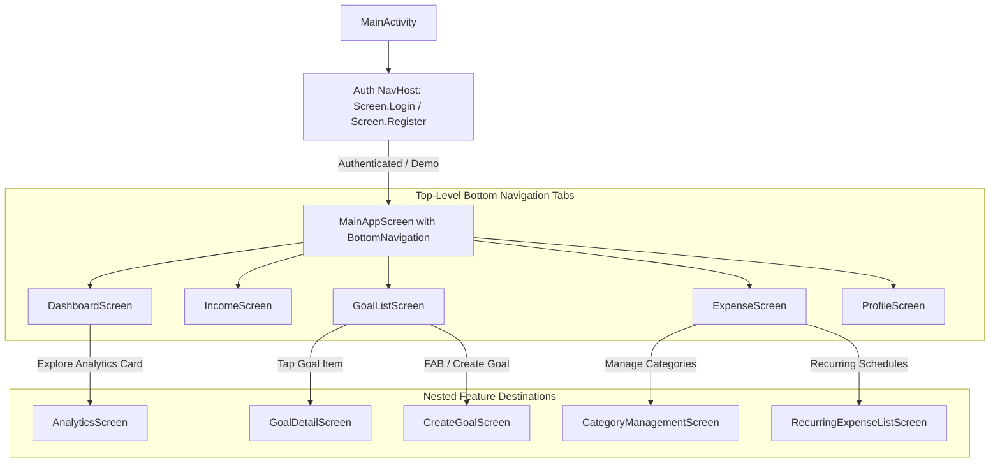

# Personal Finance Management App (PBD)

An offline-first, modern Android personal finance management system engineered in 100% Kotlin with Jetpack Compose (Material Design 3), MVVM Clean Architecture, Room database, and Google Firebase Cloud sync.

Designed for real-world personal finance scenarios—specifically tailored for young professionals navigating volatile multi-source income streams (salaries, freelance gigs, foreign currency AdSense earnings, crypto trading P&L), frictionless daily outflows across cards and cash, and high-stakes savings goals (such as funding a MacBook Pro M4).

---

## Table of Contents

- [1. Project Overview](#1-project-overview)
  - [1.1 Background & Scenario Context](#11-background--scenario-context)
  - [1.2 Key Features](#12-key-features)
  - [1.3 Technology Stack](#13-technology-stack)
- [2. Architectural Summary](#2-architectural-summary)
  - [2.1 High-Level Architecture Diagram](#21-high-level-architecture-diagram)
  - [2.2 Clean Architecture Layers](#22-clean-architecture-layers)
  - [2.3 Navigation & Single-Activity Design](#23-navigation--single-activity-design)
  - [2.4 Offline-First Synchronization Strategy](#24-offline-first-synchronization-strategy)
- [3. Firebase Configuration Steps](#3-firebase-configuration-steps)
  - [3.1 Prerequisites](#31-prerequisites)
  - [3.2 Step-by-Step Setup Guide](#32-step-by-step-setup-guide)
  - [3.3 Firestore Security Rules](#33-firestore-security-rules)
  - [3.4 Firestore Collections Hierarchy](#34-firestore-collections-hierarchy)
- [4. Build Instructions](#4-build-instructions)
  - [4.1 Prerequisites & System Requirements](#41-prerequisites--system-requirements)
  - [4.2 Building with Android Studio](#42-building-with-android-studio)
  - [4.3 Building via Command Line (Gradle)](#43-building-via-command-line-gradle)
  - [4.4 Running Automated Unit Tests](#44-running-automated-unit-tests)
  - [4.5 Troubleshooting Common Build Issues](#45-troubleshooting-common-build-issues)
- [5. Project Directory Structure](#5-project-directory-structure)

---

## 1. Project Overview

### 1.1 Background & Scenario Context

Modern professionals face unique personal finance management friction points:
1. **Volatile Multi-Source Inflows:** Fixed monthly employment base salary coupled with irregular milestone freelance payments, USD-denominated AdSense payments subject to exchange rate fluctuations, and speculative cryptocurrency trading gains/losses.
2. **Frictionless Daily Outflows:** Fragmented daily spending across credit cards, debit cards, cash ATM withdrawals, food delivery, and ride-hailing services, obscuring the split between non-negotiable committed obligations (rent, utility bills) and discretionary lifestyle expenses.
3. **Disconnected Savings Targets:** Long-term goals (such as a MacBook Pro M4 target of LKR 490,000) fail because daily financial decisions lack real-time feedback on daily allowable burn rate and goal velocity.

This application directly addresses these challenges through automated burn rate calculation (**Safe-to-Spend Runway**), dynamic multi-currency conversion, automated recurring expense tracking, and intelligent savings velocity metrics.

### 1.2 Key Features

- **Authentication & Onboarding:**
  - Secure Email/Password registration and login with input validation (RFC email compliance, 6+ character password with alphanumeric checks).
  - One-tap **"Demo Mode"** (Anonymous Authentication) pre-configured with realistic persona data for instant exploration and offline evaluations.
- **Financial Intelligence Dashboard:**
  - **Safe-to-Spend Runway:** Real-time calculation of safe daily discretionary allowance considering current month days remaining and committed liabilities.
  - **Net Cash Flow & Period Summaries:** Instant visibility into total income, committed vs. discretionary expenses, and net surplus.
  - Dynamic goal progress widget with required monthly/daily savings velocity.
- **Multi-Source Inflow Tracking:**
  - Segregated recording across 4 income streams: **Salary**, **Freelance**, **AdSense (USD)**, and **Crypto Trading**.
  - Built-in USD to LKR foreign currency exchange conversion.
  - Realised Crypto Profit & Loss (P&L) calculator (Sell Price vs. Buy Price with quantity tracking).
  - Invoice payment status lifecycle management (`RECEIVED`, `PENDING`, `OVERDUE`).
- **Comprehensive Expense & Outflow Management:**
  - Granular categorisation (Housing, Food & Dining, PickMe/Transport, Tech/Software, Entertainment, Health/Fitness, Utilities, Education).
  - Classification into **Committed** (fixed necessities) vs. **Discretionary** (lifestyle choices).
  - Payment method attribution (Cash, Credit Card, Debit Card/Bank Transfer).
  - Quick-add presets for rapid transaction capture.
- **Automated Recurring Expense Engine:**
  - Support for recurring subscriptions and liabilities across multiple frequencies (Daily, Weekly, Monthly, Annually).
  - Automatic scheduled generation of due transactions upon app launch via Room.
- **Goal Velocity & Contribution Ledger:**
  - Multi-goal tracking with customizable target amounts and deadlines.
  - Detailed deposit contribution history ledger.
  - Dynamic progress tracking, remaining shortfall calculations, and status indicators (`IN_PROGRESS`, `COMPLETED`, `OVERDUE`).
- **Zero-Dependency Visual Analytics:**
  - Custom Jetpack Compose Canvas implementations for lightweight visual reporting without bloated third-party charting libraries:
    - Expense category distribution chart.
    - Income stream breakdown chart.
    - Committed vs. Discretionary spending ratio card.
- **Profile & Financial Baseline Configuration:**
  - Editable baseline parameters (monthly base salary, committed rent, committed gym, discretionary cap, target savings rate, custom budgeting rules).
  - User profile name and password updates.

### 1.3 Technology Stack

| Layer / Aspect | Technology / Library | Version / Details |
| :--- | :--- | :--- |
| **Language** | Kotlin | `2.0.21` |
| **UI Framework** | Jetpack Compose (Material Design 3) | BOM `2024.09.00` |
| **Navigation** | Navigation Compose | `2.8.1` |
| **Architecture** | MVVM + Clean Architecture + UDF | ViewModels, StateFlow, Coroutines |
| **Local Database** | Room (SQLite ORM) with KSP | `2.8.5` |
| **Cloud Backend** | Google Firebase (Auth & Firestore) | BOM `33.4.0` |
| **Dependency Injection / Factory** | Custom ViewModel Factories & Repositories | Decoupled, testable architecture |
| **Target Platforms** | Android | `minSdk 26` (Android 8.0), `compileSdk 36` |
| **Build System** | Gradle (Kotlin DSL `.kts`) | AGP `9.2.1`, Java 17 |
| **Unit Testing** | JUnit 4, MockK, Coroutines Test | `4.13.2`, `1.13.12` |

---

## 2. Architectural Summary

### 2.1 High-Level Architecture Diagram

The application adheres to **Clean Architecture** combined with the **Model-View-ViewModel (MVVM)** pattern and **Unidirectional Data Flow (UDF)**:

```
┌────────────────────────────────────────────────────────────────────────┐
│                        UI Layer (Jetpack Compose)                      │
│   DashboardScreen    IncomeScreen     ExpenseScreen     GoalListScreen │
│   CreateGoalScreen   GoalDetailScreen AnalyticsScreen   ProfileScreen  │
└───────────────────────────────────▲────────────────────────────────────┘
                                    │  (StateFlow<UiState> / Events)
┌───────────────────────────────────▼────────────────────────────────────┐
│                       ViewModel Layer (StateFlow)                      │
│   DashboardViewModel   IncomeViewModel   ExpenseViewModel              │
│   GoalViewModel        CategoryViewModel AnalyticsViewModel            │
└───────────────────────────────────▲────────────────────────────────────┘
                                    │  (Invokes Use Cases & Repositories)
┌───────────────────────────────────▼────────────────────────────────────┐
│                       Domain Layer (Pure Kotlin)                       │
│   CalculateFinancialSnapshot        CalculateGoalProgress              │
│   CalculateRealisedPnL              ValidateEmail / ValidatePassword   │
│   Domain Models (Expense, Income, SavingsGoal, FinancialSnapshot)      │
│   Repository Interfaces (DashboardRepository, GoalRepository, etc.)    │
└───────────────────────────────────▲────────────────────────────────────┘
                                    │  (Reactive Flow Streams)
┌───────────────────────────────────▼────────────────────────────────────┐
│                        Data Layer (Repositories)                       │
│   RoomExpenseRepository             RoomIncomeRepository               │
│   RoomCategoryRepository            GoalRepositoryImpl                 │
│   DashboardRepositoryImpl           FinanceRepository (In-Memory SSOT) │
└───────────────────────────────────▲────────────────────────────────────┘
                                    │
          ┌─────────────────────────┴─────────────────────────┐
          ▼                                                   ▼
┌───────────────────────────────────┐       ┌───────────────────────────────────┐
│       Firebase Cloud Backend      │       │        Local Cache (Room)         │
│  - Firebase Authentication        │       │  - AppDatabase (SQLite)           │
│  - Cloud Firestore (Real-time)    │       │  - DAOs (Expense, Income, Cat)    │
└───────────────────────────────────┘       └───────────────────────────────────┘
```

### 2.2 Clean Architecture Layers

1. **UI Layer (`feature/*/presentation`, `ui/*`):**
   - Built entirely with declarative Jetpack Compose composables.
   - Strictly stateless or state-hoisted; composables observe immutable `UiState` via `collectAsState()` and emit user interaction events to ViewModels.
   - Zero business or formatting logic inside composables.
2. **ViewModel Layer:**
   - Survives configuration changes and manages UI state using private `MutableStateFlow` and exposed read-only `StateFlow`.
   - Executes asynchronous work within `viewModelScope` using structured coroutines.
3. **Domain Layer (`core/model`, `feature/*/domain`, `domain/*`):**
   - Pure Kotlin with zero Android framework dependencies.
   - Contains business logic use-cases (`CalculateFinancialSnapshot`, `CalculateGoalProgress`, `CalculateRealisedPnL`, `ValidateEmail`, `ValidatePassword`).
   - Declares domain repository interfaces establishing inversion of control.
4. **Data Layer (`feature/*/data`, `data/repository`, `core/data`):**
   - Implements repository interfaces.
   - Acts as mediator between the local Room SQLite cache and the remote Cloud Firestore instance.
   - Uses `FinanceRepository` as a consolidated in-memory single source of truth (SSOT) to coordinate cross-feature data aggregation.

### 2.3 Navigation & Single-Activity Design

The application follows the Android **Single-Activity Architecture** hosted in `MainActivity`:



### 2.4 Offline-First Synchronization Strategy

- **Local-First Writes:** Transactions, incomes, and categories are saved immediately to the local Room database, providing instant UI updates and zero latency.
- **Persistent Firestore Caching:** Firebase Firestore is initialized with `PersistentCacheSettings` in `FinanceApp`, ensuring full offline queries and mutations when disconnected.
- **Bi-Directional Cloud Sync:**
  - Real-time snapshot listeners in `FirebaseManager` stream remote updates to the local state when online.
  - Local additions or modifications trigger automatic cloud synchronization jobs.
  - Multi-device sync ensures seamless continuity across devices logged in with the same credentials.

---

## 3. Firebase Configuration Steps

The project uses **Firebase Authentication** and **Cloud Firestore**. Follow these steps to connect your Firebase project:

### 3.1 Prerequisites

- A Google Account to access the [Firebase Console](https://console.firebase.google.com/).
- Android package name: `com.example.pbdassignment`.

### 3.2 Step-by-Step Setup Guide

#### Step 1: Create a Firebase Project
1. Open the [Firebase Console](https://console.firebase.google.com/).
2. Click **Add project** (or **Create a project**).
3. Name your project (e.g., `finance-management-pbd`).
4. Choose whether to enable Google Analytics (optional) and click **Create project**.

#### Step 2: Register the Android App
1. On the Project Overview page, click the **Android** icon (`+ Add app`).
2. Fill in the app registration details:
   - **Android package name:** `com.example.pbdassignment` *(must match exactly)*.
   - **App nickname (optional):** `PBD Finance App`.
   - **Debug signing certificate SHA-1 (optional but recommended):**
     Generate it via terminal:
     ```bash
     keytool -list -v -keystore ~/.android/debug.keystore -alias androiddebugkey -storepass android -keypass android
     ```
     Copy and paste the `SHA-1` fingerprint.
3. Click **Register app**.

#### Step 3: Download & Place `google-services.json`
1. Download the `google-services.json` file provided by Firebase.
2. Place the file directly in the `app/` module directory:
   ```
   finance-management-app-PBD/
   └── app/
       ├── google-services.json   <-- PLACE HERE
       ├── build.gradle.kts
       └── src/
   ```
   > [!IMPORTANT]
   > Do not commit sensitive Firebase keys to public repositories. The `.gitignore` file is already configured to exclude `google-services.json`.

#### Step 4: Enable Authentication Providers
1. In the Firebase Console left navigation menu, navigate to **Build** > **Authentication**.
2. Click **Get started**.
3. Under the **Sign-in method** tab:
   - Enable **Email/Password** and click **Save**.
   - Enable **Anonymous** (used by the 1-Tap Demo Mode for examiner evaluation) and click **Save**.

#### Step 5: Create Cloud Firestore Database
1. In the Firebase Console left navigation menu, navigate to **Build** > **Firestore Database**.
2. Click **Create database**.
3. Choose a Firestore location closest to your users (e.g., `asia-south1` or `us-central1`).
4. Select **Start in test mode** for development (or apply the production rules below) and click **Create**.

### 3.3 Firestore Security Rules

Navigate to **Firestore Database** > **Rules** tab, paste the following security rules, and click **Publish**:

```javascript
rules_version = '2';
service cloud.firestore {
  match /databases/{database}/documents {
    
    // User profile and sub-collections (incomes, expenses, categories, goals, settings)
    match /users/{userId} {
      allow read, write: if request.auth != null && request.auth.uid == userId;
      
      match /{allSubcollections=**} {
        allow read, write: if request.auth != null && request.auth.uid == userId;
      }
    }
  }
}
```

### 3.4 Firestore Collections Hierarchy

The cloud database is organized per-user to guarantee multi-tenant security:

```
users/{userId}/
  ├── (user document fields: uid, email, displayName, updatedAt)
  ├── incomes/{incomeId}
  ├── expenses/{expenseId}
  ├── categories/{categoryId}
  ├── recurring_expenses/{recurringId}
  ├── goals/{goalId}
  └── settings/
        └── baseline (baseSalary, committedRent, committedGym, discretionaryBudgetCap, rules)
```

---

## 4. Build Instructions

### 4.1 Prerequisites & System Requirements

- **Operating System:** macOS, Windows, or Linux.
- **Java Development Kit (JDK):** JDK 17 (Required by Gradle and Kotlin compiler).
- **Android Studio:** Android Studio Ladybug (2024.2.1+) or newer.
- **Android SDK:**
  - `compileSdk`: 36
  - `minSdk`: 26 (Android 8.0 Oreo)
  - `targetSdk`: 36
  - SDK Build-Tools & Platform-Tools 34+ installed via SDK Manager.

### 4.2 Building with Android Studio

1. **Clone the Repository:**
   ```bash
   git clone <repository-url>
   cd finance-management-app-PBD
   ```
2. **Add `google-services.json`:**
   Copy your `google-services.json` file into the `app/` folder as detailed in [Section 3](#3-firebase-configuration-steps).
3. **Open in Android Studio:**
   - Launch Android Studio.
   - Select **Open** and choose the `finance-management-app-PBD` root directory.
   - Allow Gradle to sync dependencies and index the project.
4. **Select JDK 17 in Android Studio:**
   - Navigate to **Settings / Preferences** > **Build, Execution, Deployment** > **Build Tools** > **Gradle**.
   - Set **Gradle JDK** to **Java 17** (or `jbr-17`).
5. **Run the Application:**
   - Start an Android Emulator (API 26+) or connect an Android physical device with USB Debugging enabled.
   - Click the green **Run** button (`Shift + F10`) or select `app` in the run configurations.

### 4.3 Building via Command Line (Gradle)

On **macOS / Linux**:
```bash
# 1. Clean the project
./gradlew clean

# 2. Build Debug APK
./gradlew assembleDebug

# 3. Output APK location:
# app/build/outputs/apk/debug/app-debug.apk

# 4. Install onto a connected device or running emulator
./gradlew installDebug
```

On **Windows (Command Prompt / PowerShell)**:
```cmd
gradlew.bat clean
gradlew.bat assembleDebug
gradlew.bat installDebug
```

### 4.4 Running Automated Unit Tests

The test suite validates pure domain calculation use cases, ViewModels, and repository implementations using JUnit 4, MockK, and Kotlin Coroutines Test Dispatchers:

```bash
# Run all unit tests
./gradlew testDebugUnitTest

# View HTML Test Report:
# app/build/reports/tests/testDebugUnitTest/index.html
```

#### Test Suite Coverage:
- `CalculateFinancialSnapshotTest`: Validates Safe-to-Spend formula, runway calculations, committed vs discretionary breakdown, and edge cases.
- `CalculateGoalProgressTest`: Validates goal velocity, deadline forecasting, completed states, and deposit contributions.
- `ValidateAuthUseCaseTest`: Checks validation logic for email formats and password security policies.
- `AuthViewModelTest`: Tests login, registration, and demo authentication state flows.
- `DashboardRepositoryImplTest`: Validates reactive stream aggregation from income, expense, and goal data sources.

### 4.5 Troubleshooting Common Build Issues

- **Error: `File google-services.json is missing`:**
  - Place your `google-services.json` file into the `app/` directory. If testing locally without Firebase, you can supply a dummy `google-services.json` with package name `com.example.pbdassignment`.
- **Error: `Inconsistent JVM-target compatibility detected` or Java version error:**
  - Ensure your system `JAVA_HOME` points to JDK 17 (`java -version`).
- **Error: `Installed Build Tools revision ... is corrupted`:**
  - Open Android Studio SDK Manager, uninstall and reinstall the corresponding Android SDK Build-Tools.

---

## 5. Project Directory Structure

```
finance-management-app-PBD/
├── app/
│   ├── google-services.json              # Firebase configuration file (git-ignored)
│   ├── build.gradle.kts                  # App-level build configuration & dependencies
│   ├── proguard-rules.pro                # Proguard rules for release optimization
│   └── src/
│       ├── main/
│       │   ├── AndroidManifest.xml       # App manifest, Application class, and Activity declarations
│       │   ├── java/com/example/pbdassignment/
│       │   │   ├── FinanceApp.kt         # Application class (Firestore offline persistence config)
│       │   │   ├── MainActivity.kt       # Single Activity host with Edge-to-Edge & DB init
│       │   │   │
│       │   │   ├── core/                 # Shared cross-cutting components
│       │   │   │   ├── common/           # Resource wrapper (Loading, Success, Error)
│       │   │   │   ├── data/             # Shared in-memory FinanceRepository
│       │   │   │   ├── firebase/         # FirebaseManager (Auth & Firestore sync manager)
│       │   │   │   ├── model/            # Shared entities (ExpenseItem, IncomeItem, GoalItem, Baseline)
│       │   │   │   └── navigation/       # Screen definitions & Top-level Auth NavGraph
│       │   │   │
│       │   │   ├── feature/              # Feature modules
│       │   │   │   ├── analytics/        # Visualizations (Expense & Income breakdown, Spending ratio)
│       │   │   │   ├── authentication/   # Login & Register UI, AuthViewModel, Auth use-cases
│       │   │   │   ├── category/         # Category management (Room entities, DAO, repository, UI)
│       │   │   │   ├── dashboard/        # Clarity Dashboard (Safe-to-Spend, Snapshot, Quick actions)
│       │   │   │   ├── expense/          # Outflows tracking (Room DB, DAOs, Quick-add, List UI)
│       │   │   │   ├── goals/            # Savings Goals (MacBook Pro M4, Contribution ledger, Detail UI)
│       │   │   │   ├── income/           # Multi-source inflows (Salary, Freelance, AdSense USD, Crypto P&L)
│       │   │   │   ├── profile/          # User Profile & Financial Baseline editing dialogs
│       │   │   │   └── recurring/        # Automated recurring expense engine & generator
│       │   │   │
│       │   │   ├── domain/               # Domain use-cases (CalculateFinancialSnapshot, CalculateGoalProgress)
│       │   │   ├── data/                 # Repositories implementations (GoalRepository, DashboardRepository)
│       │   │   └── ui/                   # Theme (Color, Typography, Theme) & AppNavGraph
│       │   └── res/                      # Android resources (drawables, mipmaps, strings, themes)
│       └── test/                         # Unit tests (MockK, JUnit 4, Coroutines Test)
├── gradle/
│   ├── libs.versions.toml                # Version Catalog for dependencies and plugins
│   └── wrapper/                          # Gradle wrapper files
├── build.gradle.kts                      # Root Gradle build script
├── settings.gradle.kts                   # Project repositories and module declarations
└── README.md                             # Project documentation
```

---

## License

This project is submitted as an academic software engineering project for **Platform Based Development (SE3092)**. All rights reserved.
